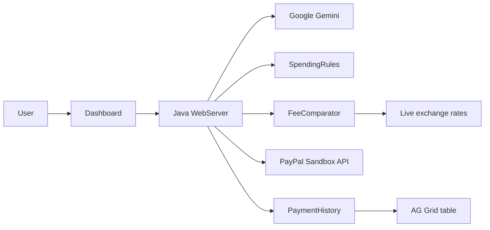

# Borderless Pay Agent

An AI payment agent that follows your spending rules, finds the cheapest way to send money abroad, and explains every decision. Built for the PayPal AI Hackathon.

**Live demo:** https://borderless-pay-agent.onrender.com (the free server can take about a minute to wake up)
**Demo video:** https://youtu.be/BQkY4cp5Qw4

## What it does
- You type a request in plain words, for example "Pay 9000 rupees tuition fee to my university abroad".
- The AI (Google Gemini) reads the sentence and extracts the recipient and amount.
- A **rules engine** decides: auto-approved, needs approval, or on hold because it is over the monthly limit. If it is over the limit, the user gets choices: approve once, raise the limit, split the payment, or schedule it for next month.
- A **fee comparison** ranks three payment routes by total cost, using a live INR to EUR and USD exchange rate.
- The AI explains the decision in simple words.
- The user can pay through a real **PayPal Sandbox** checkout (create order, approve, capture).
- Every check, payment and scheduled payment is saved in an **AG Grid** history table with status filters, a spending bar, a totals row, search, row selection and CSV export.

## Key design decision: the AI explains, the rules decide
The AI never moves money and never makes the approve or hold decision. The decision comes from plain Java code that can be read and tested. The AI only understands the request and explains the result.

## How it works


## Tech stack
| Area | Tool |
|---|---|
| Backend | Java (built-in HTTP server, no framework) |
| AI | Google Gemini API |
| Payments | PayPal Sandbox (Orders API) |
| Exchange rates | Frankfurter (ECB rates) |
| Frontend | HTML, CSS, JavaScript |
| History table | AG Grid Community |
| API testing | Postman |
| Hosting | Render (Docker) |

## Sponsor tools used
- **AG Grid:** payment history with status filters, a spending bar, a totals row, search, pagination, row selection and CSV export.
- **Postman:** a collection with automated tests in `src/borderless_pay_agent/postman/`.
- **Render:** the app is deployed from the `Dockerfile`.

## Run locally
Requirements: JDK 21 or newer.

Set these environment variables (PowerShell example):
```
$env:GEMINI_API_KEY="your key"
$env:PAYPAL_CLIENT_ID="your sandbox client id"
$env:PAYPAL_SECRET="your sandbox secret"
```
Optional: `GEMINI_MODEL` to choose the Gemini model.

Compile and run:
```
javac -d out src/borderless_pay_agent/*.java
java -cp out borderless_pay_agent.WebServer
```
Open http://localhost:8095. On Render, also set `BASE_URL` to your site address so PayPal can send the buyer back. Never commit your keys.

## Testing the PayPal checkout
The checkout uses PayPal Sandbox, so no real money moves. Test buyer login details are in the Devpost submission's testing instructions.

## API
| Method | Path | Purpose |
|---|---|---|
| POST | /api/pay | Understand a request, apply rules, compare fees, explain |
| GET | /api/history | Payment history as JSON |
| POST | /api/order | Create a PayPal sandbox order |
| POST | /api/schedule | Save a payment for next month |
| GET | /paypal/return | PayPal sends the buyer here; the order is captured |

## Safety
- Sandbox only: the code calls `api-m.sandbox.paypal.com`.
- Rate limit of 10 requests per minute per visitor and 300 per day overall, to protect the AI key.
- Input limits: 300 characters per request, and PayPal demo amounts up to Rs 50,000.
- Secrets are read from environment variables, never stored in code.
- If the free AI quota runs out, the app does not break: it falls back to a simple reader for the sentence and a fixed explanation.

## Honest limitations
- Fees in the comparison are **assumptions** for the demo (see `FeeComparator.java`). Real fees vary.
- Spending limits (auto-approve Rs 2,000, monthly Rs 20,000, spent Rs 15,000) are fixed demo values.
- Payment history is kept in memory and resets when the server restarts. It starts with a few labelled demo rows.
- Scheduled payments are saved with a due date but are not sent automatically.
- The free Gemini quota is small, so answers are remembered, and a simple fallback is used when it runs out.
- The free Render plan may need about a minute to wake up.

## Tests
```
java -cp out borderless_pay_agent.RulesTest
```
12 checks cover the spending rules and fee ranking. Also import the Postman collection and run it against a running server.