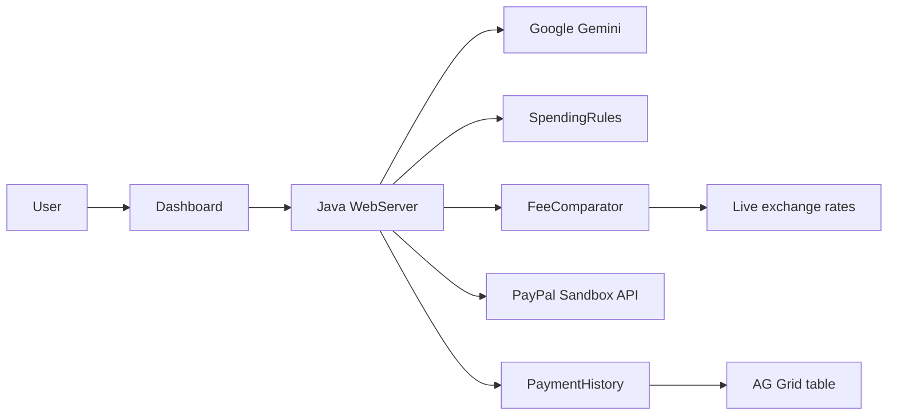

# Borderless Pay Agent

An AI payment agent that follows your spending rules, finds the cheapest way to send money abroad, and explains every decision. Built for the PayPal AI Hackathon.

**Live demo:** (add your Render link) | **Video:** (add your YouTube link)

## What it does
- You type a request in plain words, for example "Pay 9000 rupees tuition fee to my university abroad".
- The AI (Google Gemini) reads the sentence and extracts the recipient and amount.
- A **rules engine** decides: auto-approved, needs approval, or on hold because it is over the monthly limit. If it is over the limit, the user gets choices: approve once, raise the limit, split the payment, or schedule it for next month.
- A **fee comparison** ranks three payment routes by total cost, using a live INR to EUR/USD exchange rate.
- The AI explains the decision in simple words.
- The user can pay with a real **PayPal Sandbox** checkout (create order, approve, capture).
- Every check and payment is saved in a searchable **AG Grid** history table.

## Key design decision: the AI explains, the rules decide
The AI never moves money and never makes the approve/decline decision. The decision comes from plain Java code that can be read and tested. The AI only understands the request and explains the result.

## How it works


## Tech stack
| Area | Tool |
|---|---|
| Backend | Java (built-in HTTP server, no framework) |
| AI | Google Gemini API |
| Payments | PayPal Sandbox (Orders API) |
| Exchange rates | Frankfurter (ECB rates) |
| Frontend | HTML, CSS, JavaScript |
| History table | AG Grid Community |
| API testing | Postman |
| Hosting | Render (Docker) |

## Sponsor tools used
- **AG Grid:** payment history with sorting, filtering, quick search, pagination and CSV export.
- **Postman:** a collection with automated tests in `src/borderless_pay_agent/postman/`.
- **Render:** the app is deployed from the `Dockerfile`.

## Run locally
Requirements: JDK 21 or newer.

Set these environment variables (PowerShell example):
```
$env:GEMINI_API_KEY="your key"
$env:PAYPAL_CLIENT_ID="your sandbox client id"
$env:PAYPAL_SECRET="your sandbox secret"
```
Compile and run:
```
javac -d out src/borderless_pay_agent/*.java
java -cp out borderless_pay_agent.WebServer
```
Open http://localhost:8095. Never commit your keys.

## API
| Method | Path | Purpose |
|---|---|---|
| POST | /api/pay | Understand a request, apply rules, compare fees, explain |
| GET | /api/history | Payment history as JSON |
| POST | /api/order | Create a PayPal sandbox order |
| GET | /paypal/return | PayPal sends the buyer here; the order is captured |

## Safety
- Sandbox only: the code calls `api-m.sandbox.paypal.com`.
- Rate limit of 10 requests per minute per visitor and 300 per day overall, to protect the AI key.
- Input limits: 300 characters per request, PayPal demo amounts up to Rs 50,000.
- Secrets are read from environment variables, never stored in code.

## Honest limitations
- Fees in the comparison are **assumptions** for the demo (see `FeeComparator.java`). Real fees vary.
- Spending limits (auto-approve Rs 2,000, monthly Rs 20,000, spent Rs 15,000) are fixed demo values.
- Payment history is kept in memory and resets when the server restarts.
- The free Render plan may need about a minute to wake up.

## Tests
```
java -cp out borderless_pay_agent.RulesTest
```
Also import the Postman collection and run it against a running server.